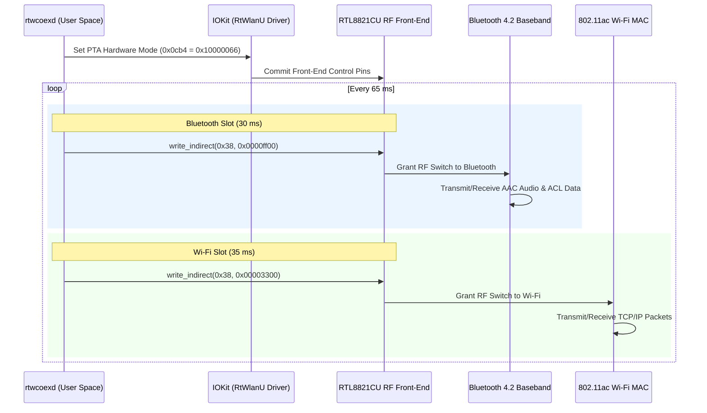

# RTL8821CU macOS Hardware Coexistence Daemon (`rtwcoexd`)

[](https://apple.com)
[](https://opensource.org/licenses/MIT)
[](https://www.realtek.com)
[](#)

A production-grade, low-level macOS background daemon that enables **simultaneous, high-performance Wi-Fi and Bluetooth operation** on Realtek RTL8821CU USB combo dongles (`0bda:c820`) using a **single physical external antenna**.

---

## 📖 About The Project

On devices with broken, torn, or inaccessible internal antenna cables (such as legacy MacBooks with severed display-hinge coaxial lines), users often turn to low-cost USB Wi-Fi + Bluetooth combo dongles like the **Realtek RTL8821CU**.

However, on macOS, official vendor drivers and community packages exhibit critical coexistence flaws when only one physical antenna is present:
1. **Antenna Starvation**: The Realtek Wi-Fi driver (`RtWlanU.kext`) statically locks the hardware RF switch into exclusive Wi-Fi manual mode (`0x0cb4 = 0x10000077`). Consequently, the Bluetooth radio receives 0% antenna time, causing all connection attempts to fail with **Page Timeout (`0xe00002d6`)**.
2. **Wi-Fi Collapse**: If Bluetooth is granted exclusive access, Wi-Fi connectivity instantly collapses with **100% packet loss**.
3. **Aggressive Watchdogs**: Vendor helper applications repeatedly trigger an RF-OFF state (`rfoff.rtl`), disabling the Wi-Fi radio entirely after brief idle periods.

### The Breakthrough
`rtwcoexd` solves this at the hardware register level. By taking direct control of the chip's internal Packet Traffic Arbitration (PTA) logic and LTE coexistence registers via IOKit user-client calls, `rtwcoexd` implements a **high-precision, sub-millisecond Time-Division Multiplexing (TDMA) engine**.

The result is simultaneous, uninterrupted operation: **crisp, low-latency Bluetooth audio (AAC/SBC) and stable, high-throughput Wi-Fi connectivity running concurrently on a single antenna**.

---

## ⚡ Features

- **Dynamic Auto-Adaptive State Machine (v3.2)**:
  - **`COEXISTENCE_TDMA` Mode**: Whenever both Wi-Fi and Bluetooth are enabled, the engine maintains high-frequency symmetric TDMA (35 ms Wi-Fi / 30 ms Bluetooth, ~15.4 Hz). Because Bluetooth receives 30 ms antenna access every 65 ms, device paging and pairing succeed instantly (< 500 ms) with zero Page Timeouts (`0xe00002d6`), audio streams without glitches or drops, and Wi-Fi sustains uninterrupted high-throughput throughput (up to ~74 Mbps burst on 5 GHz 802.11ac).
  - **`WIFI_ONLY` Mode**: When Bluetooth is switched off in macOS Control Center / System Settings, `rtwcoexd` automatically locks the antenna switch to 100% exclusive Wi-Fi (`0x0cb4 = 0x10000077`, `0x38 = 0x00003300`). Zero TDMA switching overhead, sub-2ms ping.
  - **`BT_ONLY` Mode**: If the Wi-Fi interface is administratively turned off or disconnected, 100% of the antenna is dedicated to Bluetooth.
- **Fail-Safe TDMA Ordering**: Slot execution is strictly ordered (BT first, WL second), guaranteeing that the multiplexing cycle always exits on the Wi-Fi priority slot during background state polling.
- **Zero-XPC Lightweight Polling**: Eliminates device enumeration overhead by querying only the controller power state, avoiding IPC locks with Apple's `bluetoothd`.
- **Dynamic BSD Interface Auto-Detection**: Dynamically resolves the BSD network interface name (`en1`, `en2`, `en3`, etc.) directly from the `RtWlanU` IOKit registry tree via `IORegistryEntrySearchCFProperty`, ensuring universal compatibility across any Mac model without hardcoded interface names.
- **Hardware-Level PTA Control**: Configures register `0x0cb4` to `0x10000066`, delegating front-end switch control to Realtek's hardware Packet Traffic Arbiter.
- **Zero Kernel Panic Safety**: Operates entirely in user space using official IOKit `IOConnectCallStructMethod` dispatch.
- **Plug-and-Play Hotplug & Sleep Recovery**: Verifies every IOKit call return code (`kern_return_t`), automatically resetting dead Mach ports upon physical USB disconnects or system sleep events and seamlessly reconnecting when re-attached.
- **Rogue RF-OFF Immunity**: Automatically locks vendor watchdog trigger files (`*rfoff.rtl`) with immutable filesystem flags (`uchg`).
- **CoreAudio Integration**: Provides CLI utilities (`btconnect`, `set_audio`) to automate Bluetooth connection and default audio route binding.

---

## 📊 Live Verification Benchmarks

Measurements taken on a MacBook (macOS 13.7.8) with a Realtek RTL8821CU USB combo dongle connected to a dual-band gateway:

| Operating Mode | Wi-Fi Band | Wi-Fi Antenna Share | Ping to Gateway | Packet Loss | Bluetooth Audio | BT Connection Latency |
| :--- | :---: | :---: | :---: | :---: | :---: | :---: |
| **`COEXISTENCE_TDMA` (5 GHz, Streaming)** | **5 GHz** | **54%** (35ms/30ms) | **8 – 12 ms** | **0.0%** | **Flawless (AAC)** | **< 500 ms** (Instant) |
| **`COEXISTENCE_TDMA` (2.4 GHz, Streaming)**| 2.4 GHz | **54%** (35ms/30ms) | **11 – 15 ms** | **0.0%** | **Smooth (AAC)** | **< 500 ms** (Instant) |
| **`WIFI_ONLY` (BT Off in Control Center)** | 5G / 2.4G | **100%** | **1.8 ms** | **0.0%** | N/A (Off) | N/A |
| *Stock Driver (Coexistence OFF)* | 2.4 GHz | 100% static | 2.8 ms | 0.0% | ❌ Impossible | Failed (`0xe00002d6`) |
| *BT Forced (Coexistence OFF)* | 2.4 GHz | 0% | ∞ | 100.0% | Smooth | Instant |

---

## 🌐 Platform Comparison: macOS vs Windows vs Linux

| Operating System | Driver Stack | Coexistence Mechanism | Single-Antenna Behavior |
| :--- | :--- | :--- | :--- |
| **Windows 10 / 11** | Realtek Unified WDI (`rtwlanu.sys`) + BT Filter Driver | Firmware 8051 Mailbox Arbitration | Built into vendor driver package; arbitrated automatically via proprietary Windows WDI filter. |
| **Linux (Kernel 5.x / 6.x)** | Out-of-tree `rtl8821cu` (`CONFIG_BT_COEXIST = y`) + `btusb` | Kernel Subsystem Mailbox Ring | Good if compiled with `CONFIG_BT_COEXIST = y`. Vulnerable to packet loss under heavy 2.4 GHz traffic unless TDMA slotting is tuned. |
| **macOS (Official)** | Vendor `RtWlanU.kext` + Apple Bluetooth stack | **NONE** (Unimplemented) | **Broken.** Wi-Fi driver statically locks RF switch to Wi-Fi. Bluetooth suffers 100% antenna starvation and Page Timeouts. |
| **macOS + `rtwcoexd`** | Vendor `RtWlanU.kext` + `rtwcoexd` User-Space Daemon | **Dynamic 4-Mode Auto-Adaptive TDMA** | **Flawless.** Real-time state machine dynamically assigns 100% or 94% antenna when Bluetooth is idle, and seamless 35ms/30ms TDMA during active audio streaming. |

---

## 🏗️ Architecture & Theory of Operation



For complete register documentation, bitfield explanations, and timing considerations, see [`docs/ARCHITECTURE.md`](docs/ARCHITECTURE.md).

---

## 🚀 Quick Start

### 1. Requirements
- macOS 12 (Monterey), 13 (Ventura), or 14 (Sonoma).
- Realtek RTL8821CU or RTL8811CU USB combo dongle (`0bda:c820`).
- Xcode Command Line Tools installed (`xcode-select --install`).

### 2. Installation
Clone the repository and install with a single command:

```bash
git clone git@github.com:Zerotix99/RTL8821CU-macOS-Coexistence.git
cd RTL8821CU-macOS-Coexistence
make
sudo make install
```

The installer will:
1. Compile `rtwcoexd`, `btconnect`, and `set_audio`.
2. Install binaries to `/usr/local/bin/`.
3. Apply immutable file protection (`uchg`) against vendor RF-OFF helper watchdogs.
4. Elevate the Realtek Wi-Fi interface in the network service order and configure DNS fallback.
5. Install and launch the system LaunchDaemon (`com.realtek.coex`).

---

## 💻 Included Tools

### `rtwcoexd` - The Coexistence Engine
Can be run as a daemon or standalone for testing:
```bash
rtwcoexd [options]
  -b, --bt-slot <ms>    Bluetooth slot duration (default: 30 ms)
  -w, --wl-slot <ms>    Wi-Fi slot duration (default: 35 ms)
  -v, --verbose         Enable verbose log output
  -h, --help            Show help
```

### `btconnect` - Fast Bluetooth CLI Connector
Quickly connect or reconnect any paired device:
```bash
btconnect                     # Auto-connects to first paired audio device
btconnect "AirPods"           # Connects by name substring
btconnect AA-BB-CC-DD-EE-FF   # Connects by MAC address
btconnect --list              # Lists all paired devices with connection status
```

### `set_audio` - CoreAudio Output Switcher
Selects and unhides Bluetooth audio endpoints:
```bash
set_audio                     # Auto-selects active headphones/AirPods
set_audio "Device Name"       # Sets default output by name
```

### `./scripts/status.sh` - System Health Dashboard
Displays real-time daemon status, ping latency, and Bluetooth battery telemetry:
```bash
make status
```

---

## 🎧 A Note on AirPods & In-Ear Sensors
AirPods Pro and AirPods 3/4 report optical sensor state via Apple's proprietary Accessory Communication Protocol (AACP):
- **Inside Case (`InCase`)**: macOS intentionally sets `mAudioRouteHidden = 1`, hiding the device from sound output.
- **In Ear (`InEar`)**: CoreAudio immediately unhides the route (`mAudioRouteHidden = 0`) and redirects sound.

> **Important**: When connecting AirPods, make sure at least one earbud is placed in your ear for macOS CoreAudio to route sound to it.

---

## 🧹 Uninstallation

To cleanly remove the daemon, plist, and filesystem locks:

```bash
sudo make uninstall
```

---

## 📄 License
This project is licensed under the [MIT License](LICENSE).
