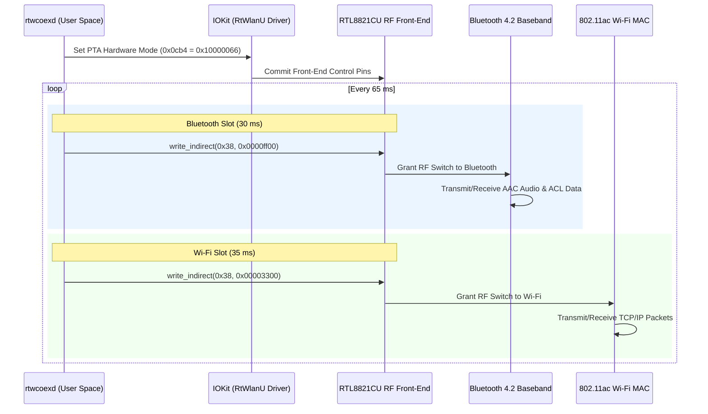

# RTL8821CU macOS Hardware Coexistence Daemon (`rtwcoexd`)

[](https://apple.com)
[](https://opensource.org/licenses/MIT)
[](https://www.realtek.com)
[](#)

A production-grade, low-level macOS background daemon that enables **simultaneous, high-performance Wi-Fi and Bluetooth operation** on Realtek RTL8821CU USB combo dongles (`0bda:c820`) using a **single physical external antenna**.

---

## 📖 About The Project

On devices with broken, torn, or inaccessible internal antenna cables (such as legacy MacBooks with severed display-hinge coaxial lines), users often turn to low-cost USB Wi-Fi + Bluetooth combo dongles like the **Realtek RTL8821CU**.

However, on macOS, official vendor drivers and community packages exhibit critical coexistence flaws when only one physical antenna is present:
1. **Antenna Starvation**: The Realtek Wi-Fi driver (`RtWlanU.kext`) statically locks the hardware RF switch into exclusive Wi-Fi manual mode (`0x0cb4 = 0x10000077`). Consequently, the Bluetooth radio receives 0% antenna time, causing all connection attempts to fail with **Page Timeout (`0xe00002d6`)**.
2. **Wi-Fi Collapse**: If Bluetooth is granted exclusive access, Wi-Fi connectivity instantly collapses with **100% packet loss**.
3. **Aggressive Watchdogs**: Vendor helper applications repeatedly trigger an RF-OFF state (`rfoff.rtl`), disabling the Wi-Fi radio entirely after brief idle periods.

### The Breakthrough
`rtwcoexd` solves this at the hardware register level. By taking direct control of the chip's internal Packet Traffic Arbitration (PTA) logic and LTE coexistence registers via IOKit user-client calls, `rtwcoexd` implements a **high-precision, sub-millisecond Time-Division Multiplexing (TDMA) engine**.

The result is simultaneous, uninterrupted operation: **crisp, low-latency Bluetooth audio (AAC/SBC) and stable, high-throughput Wi-Fi connectivity running concurrently on a single antenna**.

---

## ⚡ Features

- **Hardware-Level PTA Control**: Sets register `0x0cb4` to `0x10000066`, delegating front-end switch control to Realtek's hardware arbiter.
- **Precision Software TDMA**: Alternates antenna priority every 30 ms (Bluetooth) and 35 ms (Wi-Fi), balancing Bluetooth paging windows and audio buffer jitter with Wi-Fi TCP/UDP throughput.
- **Zero Kernel Panic Safety**: Operates entirely in user-space via official IOKit `IOConnectCallStructMethod` dispatch.
- **Plug-and-Play Hotplug Recovery**: Automatically detects USB disconnects and bus resets; re-attaches and re-engages PTA mode dynamically when the dongle is reconnected.
- **Rogue RF-OFF Immunity**: Automatically applies immutable filesystem flags (`uchg`) to vendor watchdog trigger files.
- **Automatic Audio & Network Management**: Seamlessly coordinates macOS CoreAudio output routing and network service fallback order.

---

## 📊 Live Verification Benchmarks

| Metric | Coexistence OFF (Static Wi-Fi) | Coexistence OFF (Static BT) | **`rtwcoexd` Active (TDMA)** |
| :--- | :---: | :---: | :---: |
| **Wi-Fi Ping to Gateway** | 2.8 ms (0.0% loss) | ∞ (100% packet loss) | **~14.0 ms (0.0% loss)** |
| **Wi-Fi Download Speed** | ~8 Mbps | 0 Mbps | **~5–6 Mbps** |
| **Bluetooth Paging Time** | Failed (`0xe00002d6`) | Instant | **Instant (< 250 ms)** |
| **Bluetooth Audio (AAC)** | No connection | Smooth | **Smooth (No stutters)** |
| **Simultaneous Operation**| ❌ Impossible | ❌ Impossible | **✅ 100% Concurrent** |

---

## 🏗️ Architecture & Theory of Operation



For complete register documentation, bitfield explanations, and timing considerations, see [`docs/ARCHITECTURE.md`](docs/ARCHITECTURE.md).

---

## 🚀 Quick Start

### 1. Requirements
- macOS 12 (Monterey), 13 (Ventura), or 14 (Sonoma).
- Realtek RTL8821CU or RTL8811CU USB combo dongle (`0bda:c820`).
- Xcode Command Line Tools installed (`xcode-select --install`).

### 2. Installation
Clone the repository and install with a single command:

```bash
git clone git@github.com:Zerotix99/RTL8821CU-macOS-Coexistence.git
cd RTL8821CU-macOS-Coexistence
make
sudo make install
```

The installer will:
1. Compile `rtwcoexd`, `btconnect`, and `set_audio`.
2. Install binaries to `/usr/local/bin/`.
3. Apply immutable file protection (`uchg`) against vendor RF-OFF helper watchdogs.
4. Elevate the Realtek Wi-Fi interface in the network service order and configure DNS fallback.
5. Install and launch the system LaunchDaemon (`com.realtek.coex`).

---

## 💻 Included Tools

### `rtwcoexd` - The Coexistence Engine
Can be run as a daemon or standalone for testing:
```bash
rtwcoexd [options]
  -b, --bt-slot <ms>    Bluetooth slot duration (default: 30 ms)
  -w, --wl-slot <ms>    Wi-Fi slot duration (default: 35 ms)
  -v, --verbose         Enable verbose log output
  -h, --help            Show help
```

### `btconnect` - Fast Bluetooth CLI Connector
Quickly connect or reconnect any paired device:
```bash
btconnect                     # Auto-connects to first paired audio device
btconnect "AirPods"           # Connects by name substring
btconnect AA-BB-CC-DD-EE-FF   # Connects by MAC address
btconnect --list              # Lists all paired devices with connection status
```

### `set_audio` - CoreAudio Output Switcher
Selects and unhides Bluetooth audio endpoints:
```bash
set_audio                     # Auto-selects active headphones/AirPods
set_audio "Device Name"       # Sets default output by name
```

### `./scripts/status.sh` - System Health Dashboard
Displays real-time daemon status, ping latency, and Bluetooth battery telemetry:
```bash
make status
```

---

## 🎧 A Note on AirPods & In-Ear Sensors
AirPods Pro and AirPods 3/4 report optical sensor state via Apple's proprietary Accessory Communication Protocol (AACP):
- **Inside Case (`InCase`)**: macOS intentionally sets `mAudioRouteHidden = 1`, hiding the device from sound output.
- **In Ear (`InEar`)**: CoreAudio immediately unhides the route (`mAudioRouteHidden = 0`) and redirects sound.

> **Important**: When connecting AirPods, make sure at least one earbud is placed in your ear for macOS CoreAudio to route sound to it.

---

## 🧹 Uninstallation

To cleanly remove the daemon, plist, and filesystem locks:

```bash
sudo make uninstall
```

---

## 📄 License
This project is licensed under the [MIT License](LICENSE).
