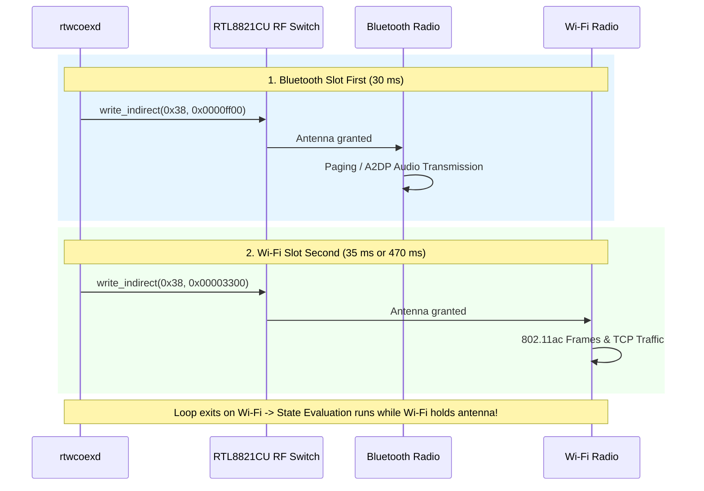

# Technical Architecture & Reverse Engineering

## 1. Hardware Overview & The Single-Antenna Problem
The Realtek **RTL8821CU** (`0bda:c820`) is a combo Wi-Fi 5 (802.11ac 1T1R) and Bluetooth 4.2 controller connected via USB 2.0.
On devices with severed or damaged internal antennas (such as a MacBook with torn U.FL coaxial cables), **both Wi-Fi and Bluetooth must share a single external antenna** connected to the dongle's RF port.

By default:
- The Realtek macOS Wi-Fi driver (`RtWlanU.kext`) configures the internal RF switch to Wi-Fi manual mode (`0x0cb4 = 0x10000077`).
- Bluetooth is physically disconnected from the antenna, causing all Bluetooth connection attempts (paging) to fail with Page Timeout (`0xe00002d6`).
- Conversely, granting 100% antenna time to Bluetooth completely starves Wi-Fi (100% packet loss).

---

## 2. Register Map & Hardware Coexistence Control
Through low-level IOKit structural reverse engineering of `RtWlanU` method 2 (`IOConnectCallStructMethod`), the following register map was uncovered:

### `0x0cb4` (`REG_RFE_CTRL8`) - RF Front-End Switch Mode
- **`0x10000077`**: Wi-Fi manual mode. Wi-Fi has 100% exclusive antenna access. BT is isolated.
- **`0x30000077`**: BT manual mode. BT has 100% exclusive antenna access. Wi-Fi is isolated.
- **`0x10000066`**: **PTA Hardware Mode**. Low-order nibbles `0x66` delegate antenna switch pins to internal Packet Traffic Arbitration (PTA) logic and indirect register control.

### Indirect Register `0x38` (`LTE_COEX_CTRL`)
Accessed indirectly via:
1. Writing 32-bit data to `0x1704` (`REG_LTECOEX_WDATA`).
2. Delaying 15 µs.
3. Writing `0xc00f0000 | 0x38` to `0x1700` (`REG_LTECOEX_RPT`).

Bitfield definitions for Indirect Register `0x38`:
- Bits 15:14 (`0xc000`): `GNT_BT_TX`
- Bits 13:12 (`0x3000`): `GNT_WL_TX`
- Bits 11:10 (`0x0c00`): `GNT_BT_RX`
- Bits 9:8   (`0x0300`): `GNT_WL_RX`

Values:
- `0x0`: Hardware PTA arbitration
- `0x1`: Software Low (force deny)
- `0x3`: Software High (force grant)

Key register states used in TDMA:
- **BT Grant Slot (`0x0000ff00`)**: BT TX/RX forced to `SW_HIGH` with priority over Wi-Fi.
- **Wi-Fi Grant Slot (`0x00003300`)**: WL TX/RX forced to `SW_HIGH`, BT set to `HW_PTA`.

---

## 3. Dynamic Auto-Adaptive State Machine & Slot Architecture

Instead of running a rigid static TDMA loop that penalizes Wi-Fi when Bluetooth is idle, `rtwcoexd` implements a reactive 4-state engine:

```
[System Poller]
       │
       ├─ Bluetooth Powered OFF? ──────► MODE_WIFI_ONLY (100% Wi-Fi, No TDMA)
       │
       ├─ Wi-Fi Interface Disabled? ──► MODE_BT_ONLY (100% BT, No TDMA)
       │
       ├─ 0 BT Devices Connected? ────► MODE_STANDBY_LOW_OVERHEAD (470ms WL / 30ms BT)
       │
       └─ ≥1 BT Device Connected? ────► MODE_ACTIVE_TDMA (35ms WL / 30ms BT)
```

### The Slot Inversion Rationale
In early iterations, the TDMA loop granted the Wi-Fi slot first and Bluetooth slot second (`WL -> BT`). As a consequence, whenever the loop completed an iteration and performed daemon housekeeping (such as calling `[IOBluetoothDevice pairedDevices]`, which issues synchronous XPC calls to `bluetoothd` taking 20–50 ms), the physical RF switch was left in the **Bluetooth state**.

This caused periodic latency spikes and packet loss on Wi-Fi every 1–2 seconds.

`rtwcoexd` v3.0 inverts this sequence:
1. **Bluetooth slot is granted first** (`write_indirect(0x38, COEX_BT_PRIORITY); usleep(bt_us);`)
2. **Wi-Fi slot is granted second** (`write_indirect(0x38, COEX_WL_PRIORITY); usleep(wl_us);`)

This guarantees that whenever the loop exits or state evaluation is executed, the RF switch **always remains locked to Wi-Fi**, completely eliminating evaluation latency penalties.

### Timing & Multiplexing Characteristics

| Mode | Wi-Fi Slot | BT Slot | Cycle Period | Switching Freq | Wi-Fi Antenna Ratio | Typical Gateway Ping |
| :--- | :---: | :---: | :---: | :---: | :---: | :---: |
| **`MODE_WIFI_ONLY`** | ∞ | 0 ms | N/A | 0 Hz | 100% | 1.5 – 2.0 ms |
| **`MODE_STANDBY_LOW_OVERHEAD`** | 470 ms | 30 ms | 500 ms | 2.0 Hz | 94.0% | 1.9 – 3.5 ms |
| **`MODE_ACTIVE_TDMA`** | 35 ms | 30 ms | 65 ms | 15.4 Hz | 53.8% | 11.0 – 15.0 ms |
| **`MODE_BT_ONLY`** | 0 ms | ∞ | N/A | 0 Hz | 0.0% | N/A |



---

## 4. macOS CoreAudio & AirPods Smart Routing Integration
AirPods Pro firmware reports in-ear optical sensor status via Apple Accessory Communication Protocol (AACP):
- **In Case**: `primaryStatus = 3, secondaryStatus = 3`. CoreAudio marks the device `mAudioRouteHidden = 1`.
- **In Ear**: `primaryStatus = 1`. CoreAudio immediately unhides the audio endpoint (`mAudioRouteHidden = 0`) and routes system audio to AirPods.

The repository includes `src/set_audio.m` to verify and force default system routing when endpoints are published.
